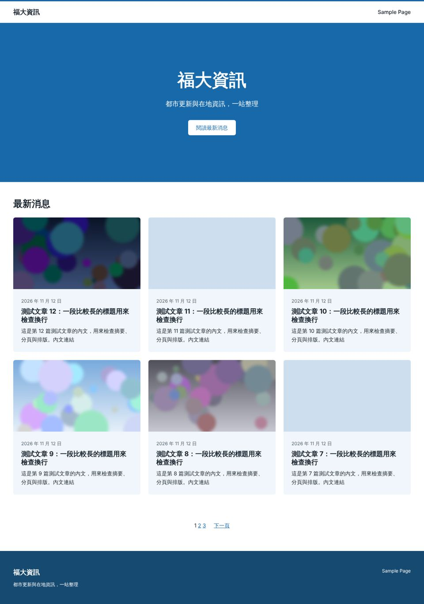
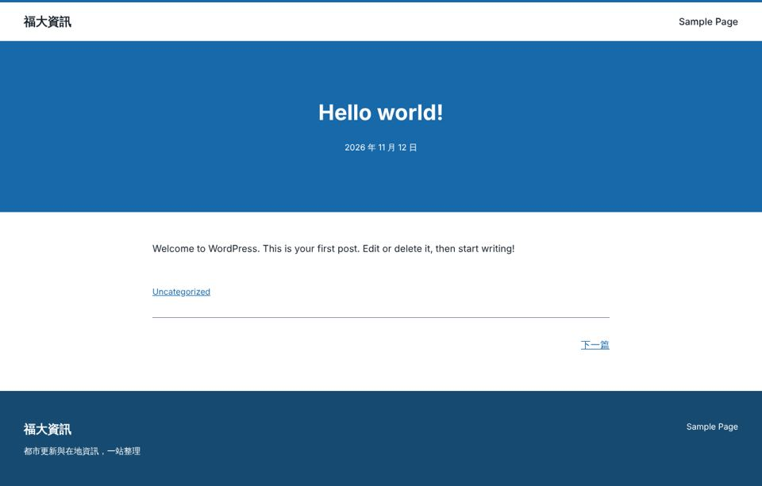
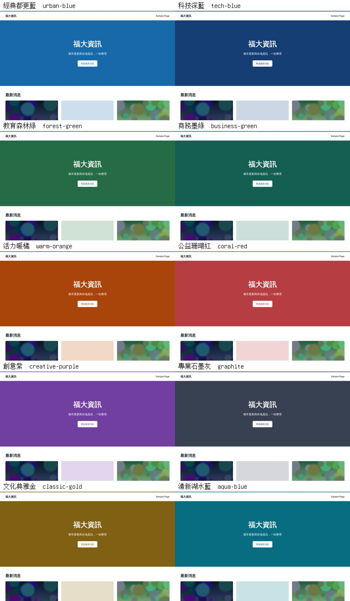
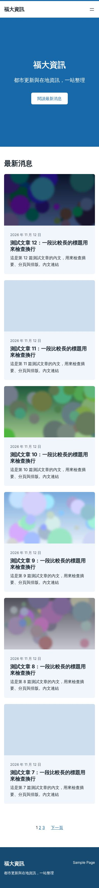

# 0.2.0 視覺版面（2026-11-15）

使用者看了 0.1.0 覺得「陽春、不美觀」。0.1.0 只有骨架；這輪做 M1 原訂的橫幅與卡片版面。

## 改動

| 區域 | 做法 |
| --- | --- |
| 首頁大橫幅 | `patterns/hero.php`（Cover 區塊，`.fu-banner`）：網站名稱（h1）、副標題、「閱讀最新消息」按鈕連到 `#latest`。圖片由各站在網站編輯器的首頁範本設定，佈景不含圖片 |
| 單篇／單頁頁首橫幅 | Cover 區塊 `useFeaturedImage`，標題（h1）與日期置中 |
| 無圖片備援 | CSS `:has()`：沒有圖片時遮罩改為 primary 實心、opacity 1 |
| 有圖片 | 70% `contrast` 遮罩 |
| 文章列表 | 卡片格線（`.fu-card`）：16:9 精選圖片、日期、標題、摘要；最小欄寬 16rem 自動換欄；無圖片時上方 16:9 淡主色區塊 |
| 分類／搜尋／文章頁 | 頂端 surface 色帶放標題（寬版對齊卡片），搜尋框限寬 36rem |
| 頁首／頁尾 | 頁首上緣 4px 主色線；頁尾 secondary 底、白字 |
| 版塊間距 | 取消頁首、內容、頁尾之間的預設間距 |
| 版本 | 0.1.0 → **0.2.0**：WordPress 依佈景版本快取 Pattern，不升版號新 Pattern 不會出現 |

區塊標記由 WordPress 7.1 編輯器的 `wp.blocks.serialize()` 產生，不是手寫。

## 驗證

| 檢查 | 結果 | 方法 |
| --- | --- | --- |
| 編輯器區塊合法性 | 通過 | [editor-validity.js](../tools/editor-validity.js)：8 個模板＋頁首頁尾在網站編輯器打開，共 152 個區塊全部 `isValid` |
| 橫幅遮罩實際套用 | 通過 | 瀏覽器 computed style：有圖片 `rgb(23,33,43)` opacity 0.7；無圖片 `rgb(23,105,170)` opacity 1 |
| 橫幅文字對比 | 通過（計算值） | 無圖片 primary-contrast／primary 最低 5.59:1（coral-red）；有圖片最差情況全白圖片＋70% 遮罩 6.00:1。未做逐像素量測 |
| 頁尾、橫幅按鈕對比 | 通過（計算值） | 頁尾白字／secondary 最低 7.39:1；按鈕 primary／白底最低 5.59:1 |
| 深色區塊焦點框 | 修正後通過 | 原本深色外框對主色只有約 2.85:1；改為白外框＋深色內圈（[focus-dark.js](../tools/focus-dark.js) 截圖確認） |
| 十套配色 | 通過 | 前台 13 色比對 11/11；首頁截圖對照見下 |
| RWD | 通過 | 1280、390px 七種頁面無橫向溢出 |
| 網站編輯器切換配色 | 通過 | editor-switch.js |
| 樣式量 | 通過 | 佈景自有 CSS／JS 檔 0；整頁 inline 樣式（含核心）gzip 8,239 bytes（0.1.0 為 7,668） |
| 圖片載入 | 通過 | 卡片圖片 `loading="lazy"` |
| 0.1.0 → 0.2.0 升級 | 通過 | 乾淨站（未開開發模式，與正式站同樣快取 Pattern）後台上傳，WordPress 顯示 0.1.0／0.2.0 比較，取代後首頁出現橫幅與「閱讀最新消息」，無 PHP 錯誤 |

ZIP：`dist/futheme-0.2.0-test.zip`，34 檔，SHA-256 `0e5374170f14956e9276dc702d6c4c3cc8d312e68f5aa49956138ae3dd1ddc61`。

## 截圖

首頁（urban-blue，無橫幅圖片時為主色）：

單篇文章（有精選圖片）：

十套配色首頁：

手機 390px：

## 未測／限制

- 測試圖片為程式產生的模糊色塊，不是真實照片；真實照片的裁切與焦點位置未看過。
- 橫幅 LCP、圖片尺寸對效能的影響未量測。
- `:has()` 與 `color-mix()` 需要 2023 年後的瀏覽器；舊瀏覽器上無圖片橫幅會顯示 70% 深色遮罩（文字仍可讀），無圖片卡片上方沒有色塊。
- 只測 Chromium；Firefox、Safari、手機實機未測。
- 卡片未加 border 邊框，與設計系統原文不同，已記錄於 [設計系統](../../docs/design-system.md)。
